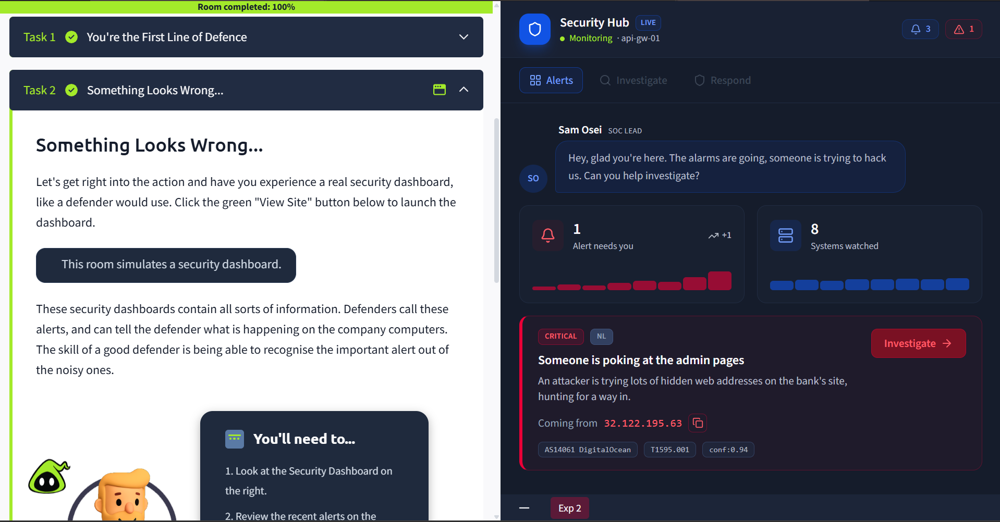

# 🛡️ TryHackMe – Defensive Security Intro

  
  
  

## 📌 Room Information

| Detail | Information |
|---|---|
| Platform | TryHackMe |
| Room | Defensive Security Intro |
| Completion Date | 26 November 2026 |
| Focus | Defensive Security / Blue Team |
| Environment | Simulated Security Dashboard |
| Status | Completed |

## 🎯 About This Room

This room introduced me to the role of a cybersecurity defender through an interactive scenario.

I worked with a simulated security dashboard to investigate suspicious activity, understand what an attacker was attempting to do, and apply defensive measures to stop the attack.

## 🧪 Practical Tasks Performed

### 1. Understanding the Defender's Role
- Learned what defensive security involves.
- Explored how defenders identify and respond to potential attacks.

### 2. Investigating Suspicious Activity
- Opened the simulated security dashboard.
- Reviewed recent security alerts.
- Identified the suspicious source IP address.

### 3. Investigating the Attack
- Used the dashboard's investigation feature.
- Reviewed the pages the attacker was attempting to access.
- Identified the latest page the attacker was trying to find.

### 4. Stopping the Attack
- Blocked the attacker's IP address.
- Applied measures to slow suspicious activity.
- Enabled additional protection.
- Verified that the dashboard confirmed the attack had been stopped.

## 🛠️ Tools & Concepts

- **Security Monitoring Dashboard:** Reviewing activity and identifying suspicious alerts.
- **SOC (Security Operations Centre):** Understanding how security teams monitor and investigate incidents.
- **IP Address Investigation:** Identifying the source of suspicious network activity.
- **Firewall Rules:** Blocking unwanted network access.
- **Rate Limiting:** Slowing excessive activity.
- **Incident Response:** Taking action to contain an ongoing attack.

## 📸 Practical Lab Evidence

Screenshots documenting my hands-on work:

### Security Dashboard

### Suspicious Activity Investigation

### Attack Investigation

### Stopping the Attack

## 📚 Key Learning Outcomes

Through this practical exercise, I gained exposure to:

- Monitoring security alerts.
- Recognising suspicious activity.
- Investigating potential attacks.
- Identifying attacker activity through dashboard information.
- Applying firewall rules to block suspicious IP addresses.
- Understanding rate limiting and protective security measures.
- Following a basic incident containment process.

## 🏅 Completion Evidence

Successfully completed the TryHackMe Defensive Security Intro room.

🔗 [View My TryHackMe Room](https://tryhackme.com/room/defensivesecurityintroexp?utm_campaign=social_share&utm_medium=social&utm_content=room&utm_source=copy&share_date=2026-11-26&sharerId=69ce6c682dda685e769a4bd8)

## 💭 My Reflection

This room helped me understand the defender's side of cybersecurity through a simulated security incident.

I particularly enjoyed investigating the security dashboard, identifying suspicious activity and applying defensive measures to stop the attack.

It gave me a beginner-friendly introduction to the type of monitoring, investigation and incident response activities associated with a Security Operations Centre (SOC).

I'm continuing to develop my cybersecurity skills through hands-on exercises and practical projects.

---

**Decode. Discover. Decide.** 🔐

*Learning by doing, one cybersecurity lab at a time.*
