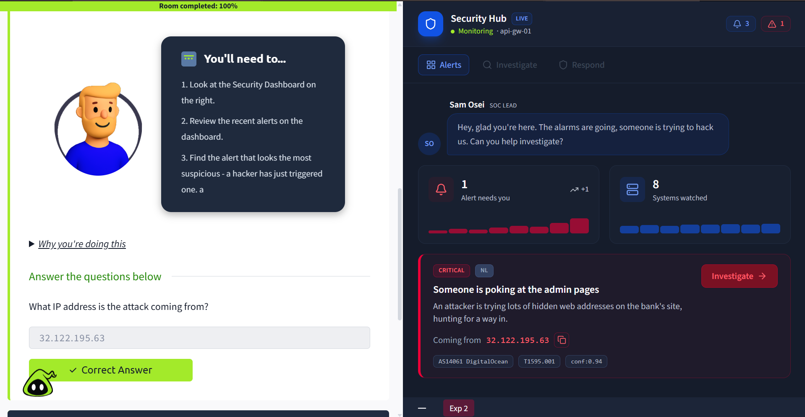
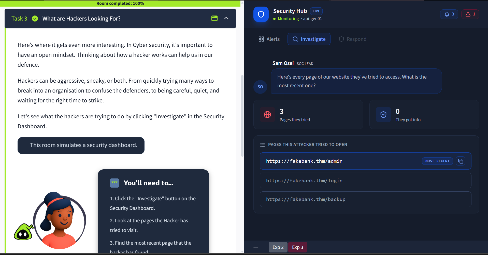
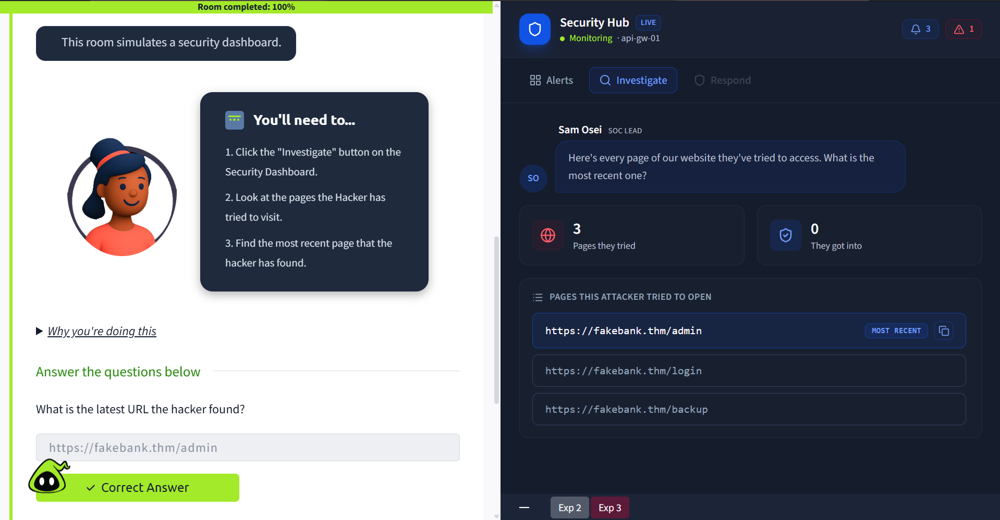
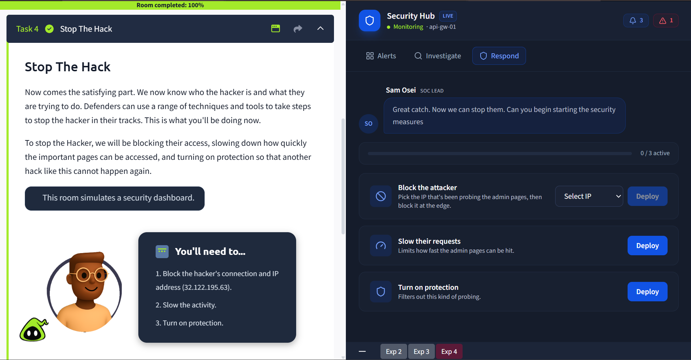
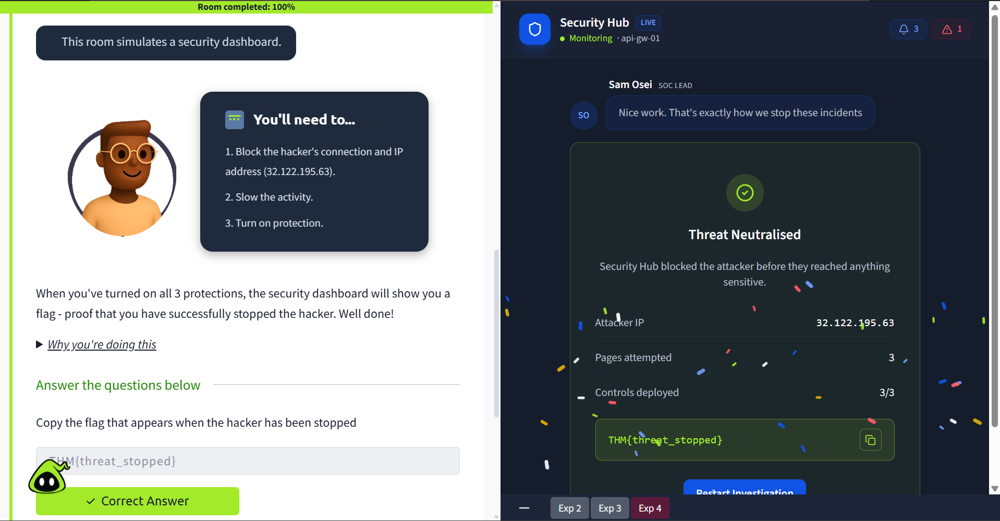

# 🛡️ TryHackMe – Defensive Security Intro

<escape></escape>
<escape></escape>
<escape></escape>

## 📌 About the Room

Completed the **Defensive Security Intro** practical learning experience on TryHackMe.

This room introduced me to the role of a defensive security professional and gave me hands-on experience investigating suspicious activity through a simulated Security Operations Centre (SOC) dashboard.

## 🎯 What I Learned

- Understanding the role of defensive security and security monitoring.
- Recognising suspicious alerts in a security dashboard.
- Identifying potentially malicious IP addresses.
- Investigating suspicious website activity and hidden pages.
- Understanding how attackers probe websites for vulnerable entry points.
- Applying defensive measures to prevent further malicious activity.

## 🔍 Practical Tasks Completed

### Task 1 – You're the First Line of Defence
Learned about the importance of defensive security and the role of security professionals in protecting systems.

### Task 2 – Something Looks Wrong
- Examined a simulated Security Hub dashboard.
- Reviewed a critical security alert.
- Identified the suspicious IP address: `32.122.195.63`.

### Task 3 – What Are Hackers Looking For?
- Investigated the pages accessed by the attacker.
- Examined the attempted website paths.
- Identified the most recent URL accessed: `https://fakebank.thm/admin`.

### Task 4 – Stop the Hack
Practised responding to the identified attack by deploying three defensive security measures:

1. **Block the attacker:** Blocked the suspicious IP address.
2. **Slow their requests:** Limited how quickly the attacker could access important pages.
3. **Turn on protection:** Enabled protection against this type of probing activity.

Successfully deployed all three measures and reached the room completion confirmation.

## 📸 Practical Lab Evidence

### 1. Security Dashboard

### 2. Identifying the Attacker's IP

### 3. Investigating the Hacker's Pages

### 4. Identifying the Latest URL

### 5. Stopping the Attack

### 6. Deploying All Security Measures

## 💡 Key Takeaway

This practical experience helped me understand that cybersecurity is not only about identifying attacks but also about responding to them effectively.

I gained a better understanding of how security teams monitor alerts, investigate suspicious behaviour and apply defensive controls to protect systems.

## 🏁 Completion

**Room Progress: 100%**

Completed on: 26 November 2026

🔗 [View My TryHackMe Achievement](https://tryhackme.com/room/defensivesecurityintroexp?utm_campaign=social_share&utm_medium=social&utm_content=share-completed-room&utm_source=copy&share_date=2026-11-26&sharerId=69ce6c682dda685e769a4bd8)

*Continuing to build my cybersecurity foundations through hands-on labs and practical learning.*

---

**Learning Area:** Cybersecurity | Defensive Security | SOC Fundamentals
